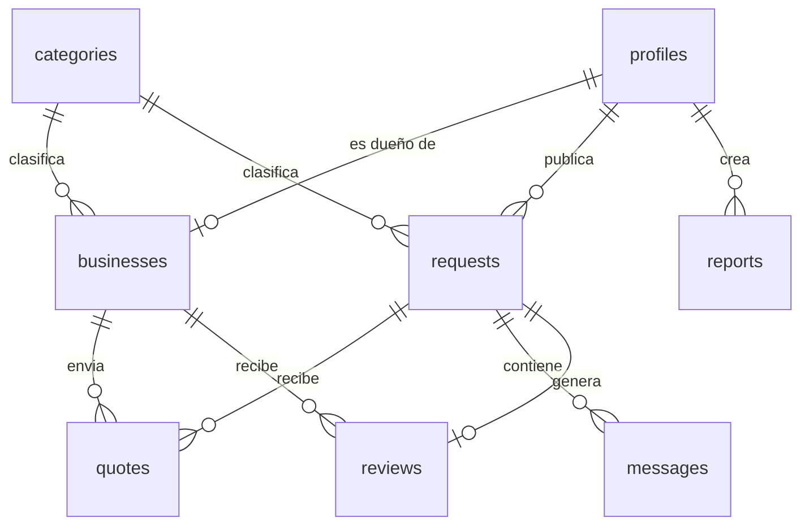

# Esquema de la base de datos

**Responsable:** Wilson (respaldo: Diego) — ver [[D-10 Wilson responsable de la base de datos]]. Todo PR con SQL lo revisan Wilson (esquema) e Iker (RLS).

Orden de creación (Plan, Parte 3, 6.1):
1. [[profiles]] — Diego — mar 3 nov
2. [[categories]] — Daniel — mar 10 nov
3. [[requests]] — Wilson — mié 11 nov
4. [[businesses]] — Daniel — jue 12 nov
5. [[reports]] — Iker — dom 15 nov
6. [[quotes]] — Diego — mar 17 nov
7. [[messages]] — Wilson — dom 13 dic
8. [[reviews]] — Iker — dom 13 dic

## Valores acordados
| Campo | Valores |
|---|---|
| profiles.role | client, provider, admin |
| requests.status | open, awarded, cancelled |
| quotes.status | pending, accepted, rejected, withdrawn |
| reports.status | open, reviewed, dismissed |
| reports.target_type | business, request, review |

Las vistas (`public_profiles`, promedio de reseñas) no tienen RLS: Wilson e Iker revisan cada una antes de fusionar.
