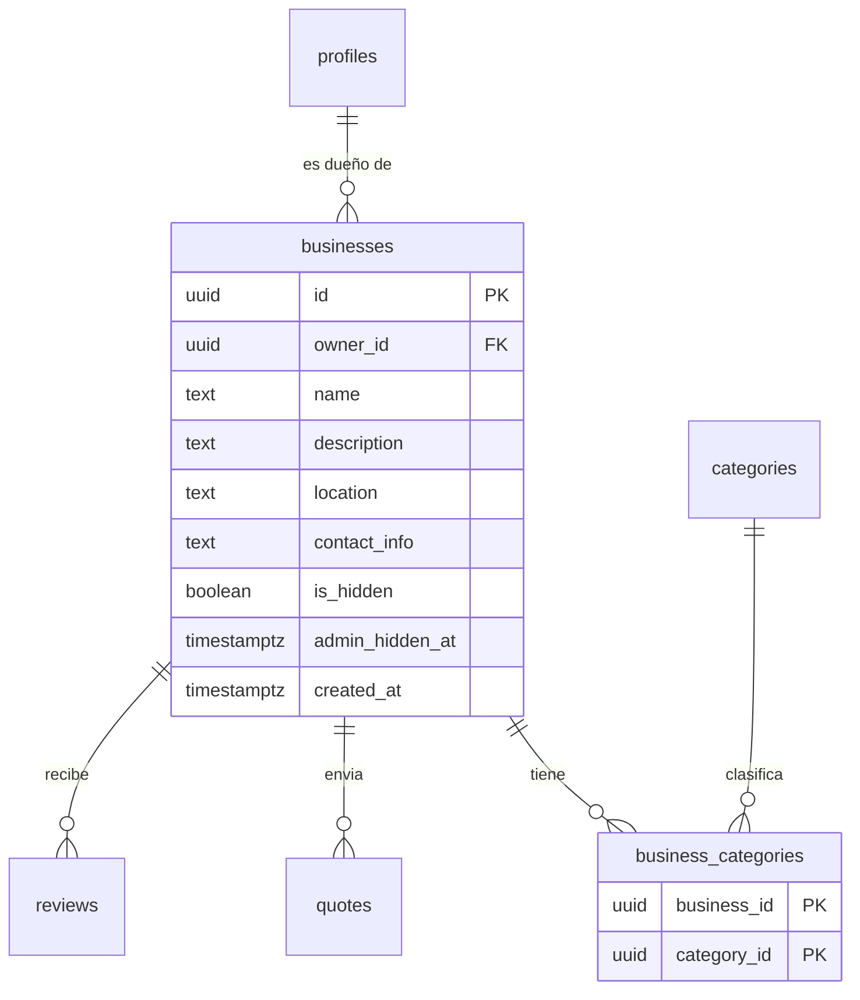

# Tabla `businesses`

**Responsable:** Daniel · **Módulo:** [[M2 Negocios y categorías]]
Los negocios de los proveedores. Un proveedor puede tener **varios** negocios y cada negocio puede tener **varias** categorías.

> Acordado en la [[Sesión de diseño (T0-07)]]. Se crea en T1-08 (#101) junto con la tabla intermedia `business_categories`.

## Diagrama

## Campos de `businesses`
| Campo | Tipo | Reglas |
|---|---|---|
| id | uuid | Clave primaria, automática |
| owner_id | uuid | → `profiles.id`. Obligatorio. **No es único**: un proveedor puede tener varios negocios |
| name | text | Obligatorio, de 2 a 100 caracteres |
| description | text | Obligatorio, hasta 1000 caracteres |
| location | text | Obligatorio: ciudad y barrio (Bogotá en el piloto) |
| contact_info | text | Obligatorio: teléfono, WhatsApp o correo comercial |
| is_hidden | boolean | Falso por defecto. Lo cambia el dueño para ocultar su negocio |
| admin_hidden_at | timestamptz | Vacío por defecto. El admin pone la fecha cuando lo oculta por una sanción; desde ahí corre el plazo |
| created_at | timestamptz | Automático |

## Políticas RLS de `businesses`
| Operación | Quién | Condición |
|---|---|---|
| SELECT | Todos | No está oculto por el dueño ni por el admin. El dueño y el admin ven también los ocultos |
| INSERT | Proveedor | Su rol es provider y `owner_id` es él mismo |
| UPDATE | Dueño | Solo sus negocios. No cambia `owner_id` ni `admin_hidden_at` |
| UPDATE | Admin | Solo `admin_hidden_at` (ocultar o quitar el ocultamiento) |
| DELETE | Dueño | Solo sus negocios. **Pendiente:** ver «Borrado» |

- [ ] Revisada por Iker con la checklist de RLS
- [ ] Probada con dos cuentas de roles distintos

## Tabla intermedia `business_categories`
Cada fila dice «este negocio tiene esta categoría». Un negocio con 3 categorías tiene 3 filas.

| Campo | Tipo | Reglas |
|---|---|---|
| business_id | uuid | → `businesses.id`. Obligatorio |
| category_id | uuid | → `categories.id`. Obligatorio |

La clave primaria son los dos campos juntos: un negocio no repite la misma categoría.

| Operación | Quién | Condición |
|---|---|---|
| SELECT | Todos | Si el negocio se puede ver |
| INSERT | Dueño del negocio | Solo en sus negocios |
| DELETE | Dueño del negocio | Solo en sus negocios |

## Ocultar y borrar
- **El dueño** puede ocultar (`is_hidden`) o borrar sus negocios.
- **El admin**, ante un problema, solo oculta (`admin_hidden_at`). Si el proveedor no resuelve la sanción en el plazo, el negocio se borra.

## Pendiente
- [ ] **Borrado:** si el dueño borra un negocio, ¿qué pasa con sus cotizaciones ([[quotes]]) y reseñas ([[reviews]])? Revisar junto con [[D-06 Claves foráneas, is_hidden y no borrar|D-06]] (cancelar u ocultar en vez de borrar). Responsables: Diego e Iker.
- [ ] **Plazo y apelación** cuando el admin oculta un negocio. Responsable: Iker (M7).
- [ ] **Al cotizar**, cómo elige el proveedor con cuál de sus negocios lo hace. Responsable: Diego (M4).

## Relaciones
- **Apunta a:** [[profiles]] (`owner_id`) y [[categories]] (a través de `business_categories`).
- **La usan:** [[quotes]] y [[reviews]] (`business_id`).

Volver a [[Esquema de la base de datos]]