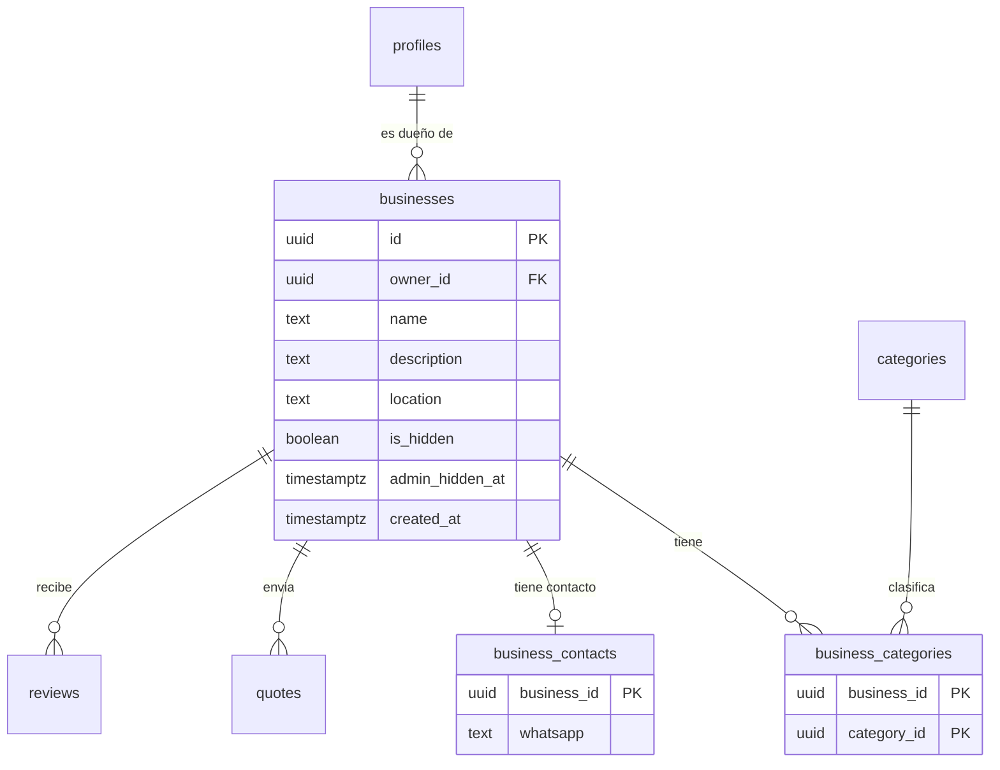

# Tabla `businesses`

**Responsable:** Daniel · **Módulo:** [[M2 Negocios y categorías]]
Los negocios de los proveedores. Un proveedor puede tener **varios** negocios y cada negocio puede tener **varias** categorías.

> Creada en offero-dev el 15 nov (T1-08, #101) junto con `business_categories` y `business_contacts`, con lo acordado en la [[Sesión de diseño (T0-07)]] y en [[D-11 Contacto entre cliente y proveedor|D-11]]. Aplicada en offero-prod el 16 nov.

## Diagrama

## Campos de `businesses`
| Campo | Tipo | Reglas |
|---|---|---|
| id | uuid | Clave primaria, automática |
| owner_id | uuid | → `profiles.id`, `on delete restrict`. Obligatorio. **No es único**: un proveedor puede tener varios negocios |
| name | text | Obligatorio, de 2 a 100 caracteres |
| description | text | Obligatorio, de 1 a 1000 caracteres |
| location | text | Obligatorio, de 2 a 100 caracteres: ciudad y barrio (Bogotá en el piloto) |
| is_hidden | boolean | Falso por defecto. Lo cambia el dueño para ocultar su negocio |
| admin_hidden_at | timestamptz | Vacío por defecto. Fecha en que el admin lo ocultó por una sanción |
| created_at | timestamptz | Automático |

El WhatsApp **no** va aquí: esta tabla la puede leer cualquiera. Va en `business_contacts` ([[D-11 Contacto entre cliente y proveedor|D-11]]).

## Permisos y políticas RLS de `businesses`
**Permisos por columna:** al crear se llenan `owner_id`, `name`, `description`, `location` e `is_hidden`; al editar solo `name`, `description`, `location` e `is_hidden`. Nadie cambia `owner_id` después de creado ni toca `admin_hidden_at` desde la app.

| Operación | Quién | Condición |
|---|---|---|
| SELECT | Visitante (`anon`) | Visibles: no ocultos por el dueño ni por el admin |
| SELECT | Con sesión | Visibles, más los propios y todos si es admin |
| INSERT | Proveedor | `get_my_role() = 'provider'` y `owner_id` es él mismo |
| UPDATE | Dueño | Solo sus negocios y solo las columnas editables |
| DELETE | Nadie | Sin permiso de borrar ([[D-06 Claves foráneas, is_hidden y no borrar\|D-06]]). Ver «Pendiente» |

Ocultar por sanción (`admin_hidden_at`) lo hará el admin con una función propia revisada por Iker (M7), como dice el README.

- [ ] Revisada por Iker con la checklist de RLS
- [ ] Probada con dos cuentas de roles distintos (T1-09, #102)

## Tabla intermedia `business_categories`
Cada fila dice «este negocio tiene esta categoría». Un negocio con 3 categorías tiene 3 filas.

| Campo | Tipo | Reglas |
|---|---|---|
| business_id | uuid | → `businesses.id`, `on delete cascade`. Obligatorio |
| category_id | uuid | → `categories.id`, `on delete restrict`: no se puede borrar una categoría en uso |

La clave primaria son los dos campos juntos: un negocio no repite la misma categoría.

| Operación | Quién | Condición |
|---|---|---|
| SELECT | Todos | Si el negocio se puede ver (hereda el RLS de `businesses`) |
| INSERT | Dueño del negocio | Solo en sus negocios |
| DELETE | Dueño del negocio | Solo en sus negocios |

## Tabla `business_contacts` (D-11)
| Campo | Tipo | Reglas |
|---|---|---|
| business_id | uuid | Clave primaria y → `businesses.id`, `on delete cascade`. Un contacto por negocio |
| whatsapp | text | Obligatorio. Celular colombiano: 10 dígitos y empieza por 3 (`check (whatsapp ~ '^3[0-9]{9}$')`) |

| Operación | Quién | Condición |
|---|---|---|
| SELECT | Dueño del negocio | Solo sus negocios. Los visitantes no tienen permiso |
| INSERT | Dueño del negocio | Solo en sus negocios |
| UPDATE | Dueño del negocio | Solo el número |

La política para que lo vea el cliente que eligió una cotización se agrega en OFF-062 (Sprint 4), cuando existan [[quotes]] y [[requests]].

## Pendiente
- [ ] **Borrado:** el equipo dijo en la sesión que el dueño puede borrar, pero D-06 propone ocultar en vez de borrar. ¿Qué pasa con sus cotizaciones ([[quotes]]) y reseñas ([[reviews]])? Mientras se decide, nadie borra. Responsables: Diego e Iker.
- [ ] **Plazo y apelación** cuando el admin oculta un negocio, y la función para ocultar. Responsable: Iker (M7).
- [ ] **Al cotizar**, cómo elige el proveedor con cuál de sus negocios lo hace. Responsable: Diego (M4).

## Relaciones
- **Apunta a:** [[profiles]] (`owner_id`) y [[categories]] (a través de `business_categories`).
- **La usan:** [[quotes]] y [[reviews]] (`business_id`).

Volver a [[Esquema de la base de datos]]