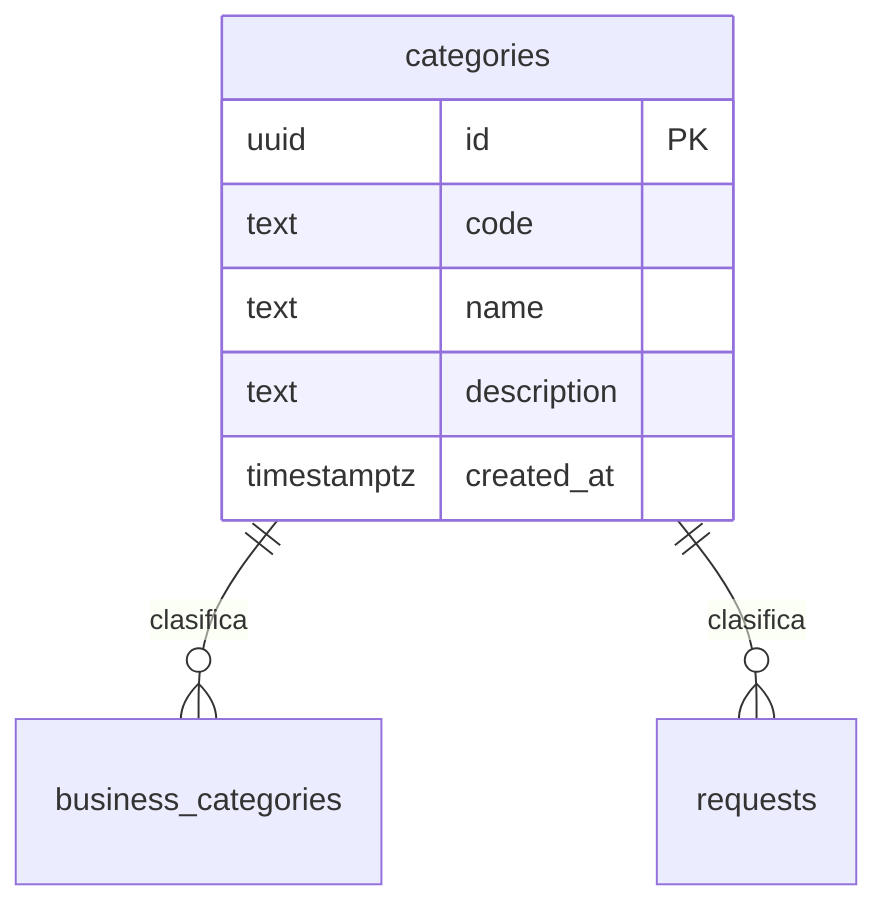

# Tabla `categories`

**Responsable:** Daniel · **Módulo:** [[M2 Negocios y categorías]]
Categorías reales que define el PO. Las usan los negocios (a través de `business_categories`) y las solicitudes.

> Creada en offero-dev el 9 nov (T1-06, #99). La columna `code` se acordó en la [[Sesión de diseño (T0-07)]] y se agrega con un archivo SQL nuevo.

## Diagrama

## Campos
| Campo | Tipo | Reglas |
|---|---|---|
| id | uuid | Clave primaria, automática. Es lo que guardan las otras tablas |
| code | text | Obligatorio y único. Letras y números, por ejemplo `Tec01`. **Pendiente:** formato exacto (lo define Daniel) |
| name | text | Obligatorio, único, de 2 a 60 caracteres |
| description | text | Opcional |
| created_at | timestamptz | Automático |

## Políticas RLS
| Operación | Quién | Condición |
|---|---|---|
| SELECT | Todos, incluso sin sesión (`anon`) | Siempre |
| INSERT | Admin | `is_admin()` |
| UPDATE | Admin | `is_admin()` |
| DELETE | Admin | `is_admin()` |

`is_admin()` no funciona para `anon`, por eso la lectura pública es una política aparte. Iker está de acuerdo en que solo el admin cambie las categorías (su panel de M7).

- [ ] Revisada por Iker con la checklist de RLS
- [ ] Probada con dos cuentas de roles distintos

## Relaciones
- **La usan:** [[businesses]] (a través de `business_categories`, porque un negocio puede tener varias categorías) y [[requests]] (`category_id`, una categoría por solicitud).
- **Borrado:** si una categoría está en uso, no se puede borrar. **Pendiente:** confirmar con el equipo.

Volver a [[Esquema de la base de datos]]