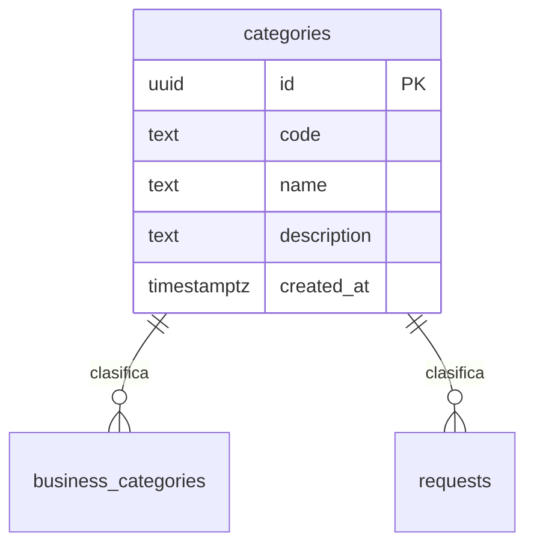

# Tabla `categories`

**Responsable:** Daniel · **Módulo:** [[M2 Negocios y categorías]]
Categorías reales que define el PO. Las usan los negocios (a través de `business_categories`) y las solicitudes.

> Creada en offero-dev el 9 nov (T1-06, #99). La columna `code` se acordó en la [[Sesión de diseño (T0-07)]] y se agregó el 11 nov con `20261111_2239_categories_code.sql`.

## Diagrama

## Campos
| Campo | Tipo | Reglas |
|---|---|---|
| id | uuid | Clave primaria, automática. Es lo que guardan las otras tablas |
| code | text | Obligatorio y único. Una mayúscula, dos minúsculas y dos números, sin tildes ni ñ (`Tec01`, `Hog02`). Regla: `check (code ~ '^[A-Z][a-z]{2}[0-9]{2}$')` |
| name | text | Obligatorio, único, de 2 a 60 caracteres |
| description | text | Opcional |
| created_at | timestamptz | Automático |

## Categorías iniciales
Lista **provisional** que definió el PO (Diego) el 12 nov 2026 para T1-07 (#100). Se ajusta con las entrevistas (OFF-056).

| Código | Nombre | Descripción |
|---|---|---|
| `Tec01` | Tecnología | Computadores, celulares, accesorios, páginas web, soporte técnico y reparación de equipos. |
| `Hog01` | Hogar y reparaciones | Plomería, electricidad, pintura, cerrajería y arreglos locativos. |
| `Con01` | Construcción y remodelación | Obras, remodelaciones, materiales y acabados. |
| `Eve01` | Eventos | Alquiler de mobiliario, sonido, decoración y fotografía para eventos. |
| `Ali01` | Alimentos y bebidas | Refrigerios, almuerzos para empresas, catering y bebidas. |
| `Dis01` | Diseño e impresión | Diseño gráfico, impresión, pendones, tarjetas y material publicitario. |
| `Ofi01` | Oficina y papelería | Útiles, papelería, insumos y muebles de oficina. |
| `Ase01` | Aseo y limpieza | Limpieza de oficinas y hogares, y productos de aseo. |
| `Tra01` | Transporte y mudanzas | Mudanzas, acarreos, mensajería y envíos dentro de Bogotá. |
| `Dot01` | Dotación y uniformes | Uniformes, dotación de trabajo, ropa corporativa y bordados. |
| `Bel01` | Belleza y cuidado personal | Peluquería, barbería, manicure, maquillaje y estética, en local o a domicilio. |
| `Otr01` | Otros | Lo que no encaja en ninguna otra categoría. Se revisa con las entrevistas para crear categorías nuevas. |

**Cómo se leen los códigos** (como el estándar UNSPSC, que agrupa por niveles):
- Las **3 letras** son el nicho (`Tec` = tecnología).
- Los **2 números** son la subcategoría dentro del nicho. Hoy cada nicho tiene una sola (`01`). Si un nicho se divide, las nuevas siguen con `02`, `03`… (por ejemplo, `Tec02` Celulares).
- **Un código nunca cambia ni se reutiliza.** El nombre y la descripción sí se pueden corregir.
- Si a `Otr01` llegan muchas solicitudes parecidas, es señal de que falta una categoría.

## Políticas RLS
| Operación | Quién | Condición |
|---|---|---|
| SELECT | Todos, incluso sin sesión (`anon`) | Siempre |
| INSERT | Admin | `is_admin()` |
| UPDATE | Admin | `is_admin()` |
| DELETE | Admin | `is_admin()` |

`is_admin()` no funciona para `anon`, por eso la lectura pública es una política aparte. Iker está de acuerdo en que solo el admin cambie las categorías (su panel de M7).

- [ ] Revisada por Iker con la checklist de RLS
- [ ] Probada con dos cuentas de roles distintos

## Relaciones
- **La usan:** [[businesses]] (a través de `business_categories`, porque un negocio puede tener varias categorías) y [[requests]] (`category_id`, una categoría por solicitud).
- **Borrado:** si una categoría está en uso, no se puede borrar. **Pendiente:** confirmar con el equipo.

Volver a [[Esquema de la base de datos]]