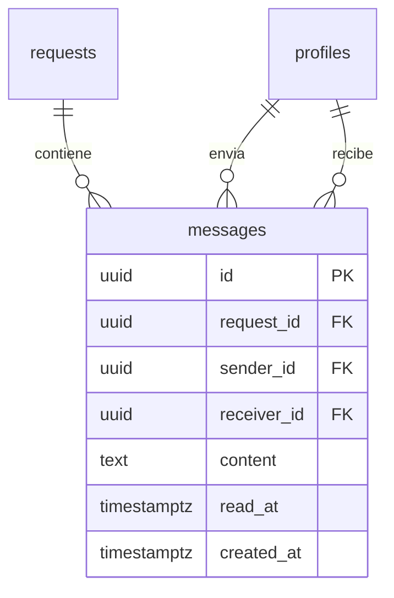

# Tabla `messages`

**Responsable:** Wilson · **Módulo:** [[M5 Mensajería]]
Mensajes de texto entre el cliente de una solicitud y los proveedores que la cotizaron.

> **Propuesta a grandes rasgos para la [[Sesión de diseño (T0-07)]].** Se crea en diciembre (dom 13 dic), después de `quotes`, y se detalla con Diego.

## Diagrama

## 1. Campos
| Campo | Tipo | Reglas |
|---|---|---|
| id | uuid | Clave primaria, automática. |
| request_id | uuid → `requests.id` | Obligatorio: la solicitud de la conversación. |
| sender_id | uuid → `profiles.id` | Obligatorio. Por defecto `auth.uid()`: quien envía es el usuario actual. |
| receiver_id | uuid → `profiles.id` | Obligatorio. Distinto de `sender_id` (CHECK). |
| content | text | Obligatorio, de 1 a 2000 caracteres (CHECK). |
| read_at | timestamptz | Vacío = no leído. |
| created_at | timestamptz | Automático. |

## 2. Claves foráneas
Las tres con `restrict`: no se borran solicitudes ni perfiles con mensajes ([[D-06 Claves foráneas, is_hidden y no borrar|D-06]]).

## 3. Estados
No tiene `status`. Solo cambia `read_at`, cuando el destinatario abre la conversación.

## 4. Permisos
Quién puede hablar: solo el cliente de la solicitud y los dueños de los negocios que la cotizaron ([[D-07 Quién puede enviar mensajes|D-07]]).

**Permisos por columna:** `anon` ninguno; `authenticated` `select`, `insert (request_id, receiver_id, content)` y `update (read_at)`.

| Operación | Quién                 | Condición                                                                                                                                                      |
| --------- | --------------------- | -------------------------------------------------------------------------------------------------------------------------------------------------------------- |
| SELECT    | Participantes         | Solo si eres `sender_id` o `receiver_id`. El admin no lee mensajes privados.                                                                                   |
| INSERT    | Participantes válidos | `sender_id = (select auth.uid())`, la solicitud no está oculta y la pareja cumple D-07. Lo revisa una función de ayuda `can_message(request_id, receiver_id)`. |
| UPDATE    | Destinatario          | Solo `read_at`, y solo si eres `receiver_id`. Nadie edita el contenido.                                                                                        |
| DELETE    | Nadie                 | —                                                                                                                                                              |

## 5. Moderación
**Propuesta:** no lleva `is_hidden`. Los mensajes son privados y el admin no los lee. Si una solicitud se oculta, ya no se pueden enviar mensajes nuevos en ella.

**Idea de la sesión de diseño:** si un usuario usa lenguaje inapropiado, se le podría dar una **advertencia** o **limitarle los mensajes**. Falta definir cómo se reporta un mensaje, quién decide la sanción y cuánto dura. Ver [[Sesión de diseño (T0-07)]].

> M5 quedó como P1 por [[D-11 Contacto entre cliente y proveedor|D-11]]: el contacto del MVP es por WhatsApp. Esta tabla se diseña en detalle después del núcleo.

## Para decidir en la sesión
1. ¿Se confirma D-07 (hoy está como propuesta)?
2. ¿El admin puede leer mensajes cuando hay un reporte? **Propuesta:** no en el MVP.
3. `can_message` necesita `quotes` y `businesses`: se escribe con Diego cuando existan.

- [ ] Revisada por Iker con la checklist de RLS
- [ ] Probada con dos cuentas de roles distintos

## Relaciones
- Apunta a [[requests]] (`request_id`) y a [[profiles]] (`sender_id` y `receiver_id`).
- Depende de [[quotes]] y [[businesses]] para saber quién cotizó.

Volver a [[Esquema de la base de datos]]
