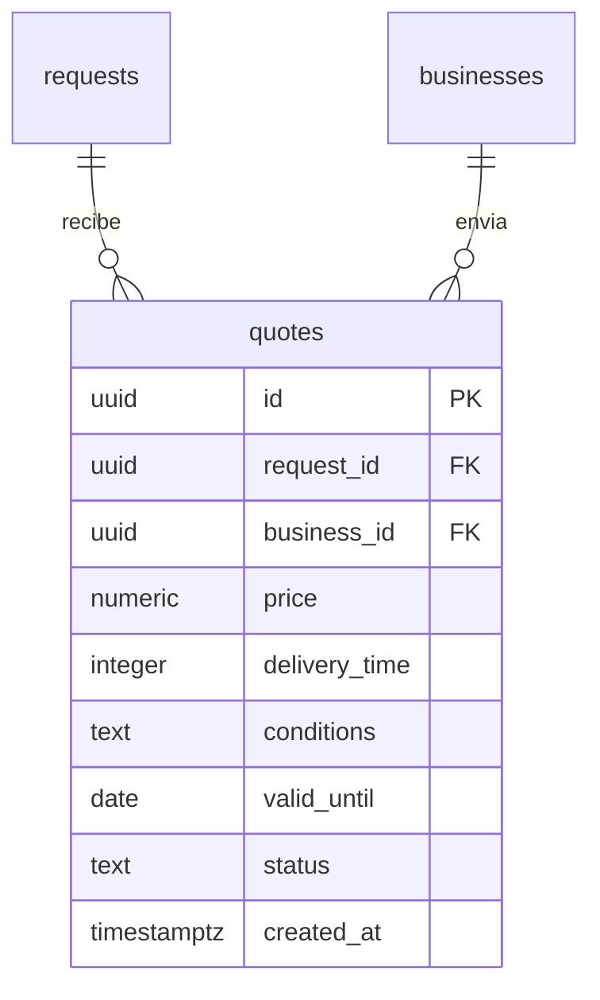

# Tabla `quotes`

**Responsable:** Diego · **Módulo:** [[M4 Cotizaciones]]
Cotizaciones que un negocio envía a una solicitud. Cada proveedor ve solo las suyas y el cliente ve todas las de sus solicitudes.

> **Creada en offero-dev el 24 nov 2026** con `supabase/sql/20261124_1414_quotes.sql` (OFF-029, #30). La hizo Daniel mientras Diego está incapacitado. **Falta offero-prod:** la aplica Wilson antes de fusionar el PR.

## Diagrama

## Campos
| Campo | Tipo | Reglas |
|---|---|---|
| id | uuid | Automático |
| request_id | uuid | → `requests.id`, borrado en cascada |
| business_id | uuid | → `businesses.id`, no se puede borrar un negocio con cotizaciones |
| price | numeric(12,2) | Mayor que 0 (en pesos). Número, no texto: así se ordena bien |
| delivery_time | integer | Días, mayor que 0 |
| conditions | text | Opcional, hasta 1000 caracteres |
| valid_until | date | Obligatoria. Que no sea pasada se valida en el servidor al crear |
| status | text | `pending` (por defecto), `accepted`, `rejected`, `withdrawn` |
| created_at | timestamptz | Automático |

**Única:** (`request_id`, `business_id`): un negocio cotiza una sola vez cada solicitud. Si la retira, no puede volver a cotizar esa misma solicitud.

## Permisos por columna
- `anon`: nada.
- `authenticated`: SELECT; INSERT solo de `request_id, business_id, price, delivery_time, conditions, valid_until` (el `status` sale `pending`); UPDATE solo de `status`.

## Políticas RLS
| Operación | Quién | Condición |
|---|---|---|
| SELECT | Proveedor | Las de sus negocios |
| SELECT | Cliente | Las de sus solicitudes |
| SELECT | Admin | Todas (`is_admin()`) |
| INSERT | Proveedor | Negocio suyo y no sancionado, solicitud `open` y no oculta, `status = pending` |
| UPDATE | Proveedor | Solo retirar: de `pending` a `withdrawn`, y solo las suyas |
| DELETE | Nadie | Sin política ni permiso: una cotización se retira, no se borra (D-06) |

El cliente **no** actualiza directo: acepta con la función de OFF-033, que pone la elegida en `accepted`, las demás en `rejected` y la solicitud en `awarded` a la vez.

Las subconsultas de las políticas pasan por el RLS de `businesses` y `requests`, y ninguna de esas tablas consulta `quotes`, así que no hay recursión. **Ojo para el Sprint 3:** si `requests` agrega una política para que el proveedor vea las solicitudes que cotizó (está anotado en su SQL), esa política consultaría `quotes` y `quotes` consulta `requests`: hay que hacerlo con una función `security definer` para no crear un ciclo.

- [ ] Revisada por Iker con la checklist de RLS
- [x] Probada con dos cuentas de roles distintos (22 pruebas en dev, ver el PR)

## Relaciones
- Apunta a [[requests]] y a [[businesses]].
- La usarán M4 (enviar, comparar y elegir cotizaciones), M5 ([[messages]]) y M6 ([[reviews]]).

Volver a [[Esquema de la base de datos]]
