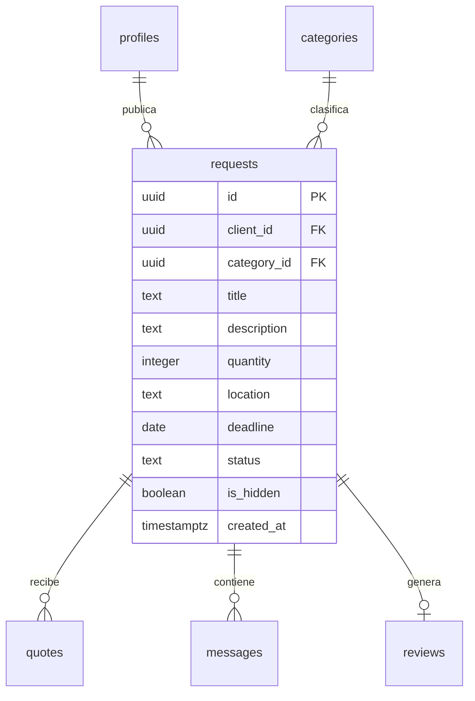

# Tabla `requests`

**Responsable:** Wilson · **Módulo:** [[M3 Solicitudes]]
Solicitudes de los clientes: qué necesitan, cuánto, dónde, para cuándo y de qué categoría.

> **Creada en offero-dev el 12 nov 2026** con `supabase/sql/20261112_1619_requests.sql` (T1-11, #104). Falta offero-prod: se aplica antes de fusionar el PR. Las pruebas de permisos son T1-12 (#105).

## Diagrama

## 1. Campos
| Campo | Tipo | Reglas |
|---|---|---|
| id | uuid | Clave primaria, automática (`gen_random_uuid()`). |
| client_id | uuid → `profiles.id` | Obligatorio. Por defecto `auth.uid()`: se llena solo con el usuario actual. |
| category_id | uuid → `categories.id` | Obligatorio. |
| title | text | Obligatorio, de 5 a 120 caracteres (CHECK). |
| description | text | Obligatorio, de 10 a 2000 caracteres (CHECK). El mínimo de 10 está por confirmar con Diego. |
| quantity | integer | Obligatorio, mayor que 0 (CHECK). |
| location | text | Obligatorio, de 2 a 200 caracteres (CHECK): ciudad y barrio. |
| deadline | date | Obligatorio. Solo fecha, sin hora. Que sea futura se valida en el servidor al crear. |
| status | text | `open`, `awarded` o `cancelled` (CHECK). Por defecto `open`. |
| is_hidden | boolean | Por defecto `false`. Solo lo cambia el admin. |
| created_at | timestamptz | Automático (`now()`). |

La fecha futura no va en un CHECK: el CHECK se revisa en cada `update`, y una solicitud vieja fallaría al cancelarla.

## 2. Claves foráneas
| Campo | Apunta a | Al borrar |
|---|---|---|
| client_id | `profiles.id` | `restrict`: no se puede borrar un perfil con solicitudes. |
| category_id | `categories.id` | `restrict`: no se puede borrar una categoría con solicitudes. |

No se borra nada ([[D-06 Claves foráneas, is_hidden y no borrar|D-06]]): una solicitud se cancela y el admin la oculta.

## 3. Estados
| De | A | Quién |
|---|---|---|
| — | `open` | El cliente, al crearla. |
| `open` | `cancelled` | El cliente dueño. |
| `open` | `awarded` | Solo la función de aceptar cotización de Diego (M4). Nadie lo pone a mano. |

`awarded` y `cancelled` son finales.

## 4. Permisos
Los dos candados, como en [[profiles]]: **permisos** (qué columnas) y **RLS** (qué filas).

**Permisos por columna:**
- `anon`: ninguno.
- `authenticated`: `select`; `insert (category_id, title, description, quantity, location, deadline)`; `update (category_id, title, description, quantity, location, deadline, status)`.
- Nadie puede escribir `client_id`, `is_hidden` ni `created_at`.

**Políticas RLS:**
| Operación | Quién | Condición |
|---|---|---|
| SELECT | Cliente | Las suyas: `client_id = (select auth.uid())`. |
| SELECT | Proveedor | Las `open` y no ocultas: `(select public.get_my_role()) = 'provider'`, `status = 'open'` y `is_hidden = false`. Cuando exista `quotes`, también las que cotizó. |
| SELECT | Admin | Todas: `(select public.is_admin())`. |
| INSERT | Cliente | `(select public.get_my_role()) = 'client'`, `client_id = (select auth.uid())` y `status = 'open'`. |
| UPDATE | Cliente dueño | `using`: es suya y está `open`. `with check`: sigue siendo suya y `status` es `open` o `cancelled`. Así no puede poner `awarded`. |
| DELETE | Nadie | Se cancela en vez de borrar. |

Todas las políticas van `to authenticated`.

## 5. Moderación
Lleva `is_hidden`. Una solicitud oculta deja de verla el proveedor; el cliente y el admin sí la siguen viendo. Ocultar lo hace el admin con una función propia en M7 (Iker).

## Cómo quedó en el SQL
- `anon` no ve solicitudes en el MVP: no tiene ningún permiso sobre la tabla.
- Las dos claves foráneas quedaron con `restrict`.
- Índices en `client_id`, `category_id` y `status`.

## Pendiente
1. ¿Se puede editar una solicitud que ya tiene cotizaciones? **Propuesta:** no, para que nadie cambie las condiciones después de que los proveedores cotizaron. Se aplica cuando exista `quotes`. Decide el PO (duda 3).
2. Confirmar el mínimo de 10 caracteres de `description`.
3. Cuando exista `quotes`: el proveedor también ve las solicitudes que cotizó (Sprint 3, con Diego).

- [ ] Revisada por Iker con la checklist de RLS
- [x] Probada con dos cuentas de roles distintos (T1-12, #105, 13 nov 2026: 33 de 33 pruebas correctas con visitante, cliente A, cliente B, proveedor y admin)

## Relaciones
- Apunta a [[profiles]] (`client_id`) y a [[categories]] (`category_id`).
- La usan [[quotes]] (`request_id`), [[messages]] (`request_id`) y [[reviews]] (una por solicitud adjudicada).
- Se puede reportar desde [[reports]] (`target_type = request`).

Volver a [[Esquema de la base de datos]]
